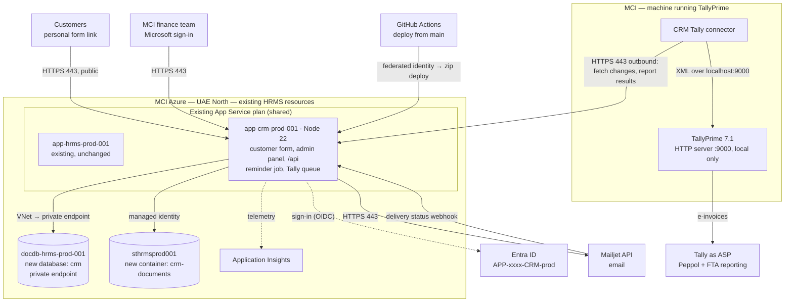
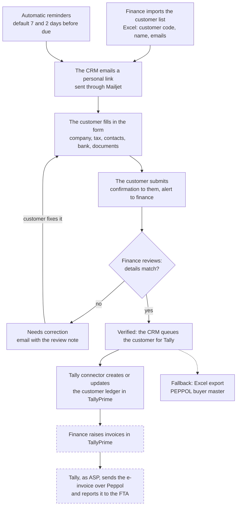

# MCI CRM — Azure Hosting Proposal (e-Invoicing phase)

Application: MCI CRM, customer master and e-invoicing data · Neuvelabs Technologies, for MCI IT · 3 November 2026

---

## 1. Summary

We propose hosting the CRM on the Azure resources MCI already runs for HRMS. It adds a second app to the HRMS App Service plan, a new database on the HRMS DocumentDB cluster and a new container in the HRMS storage account. No new plan or cluster is needed, so the new monthly cost is mainly storage and logs. MCI staff sign in with their Microsoft account, as in HRMS.

**What the CRM does.** It is MCI Middle East's customer master. Phase 1 collects the buyer details UAE e-invoicing (PINT AE) needs from every customer: legal name, trade licence, TRN, TIN, PEPPOL ID, contacts, bank details and supporting documents. Each customer fills in one form from a personal link, with no account. The finance team reviews each submission.

**Name and hostname.** We suggest **MCI CRM** at **`crm-ae.wearemci.com`**, matching `hrms-ae`. The system will hold more than e-invoicing data, so a name tied to e-invoicing would date quickly. 

**What we ask MCI IT for (Option A, shared)**

| Item | Name | Notes |
| --- | --- | --- |
| Web app on the existing HRMS plan | `app-crm-prod-001` | Linux, Node 22 LTS, 1 instance, Always On, VNet integration like HRMS |
| Database on the existing cluster | database `crm` on `docdb-hrms-prod-001` | Created by the app on first start |
| Container in the existing storage account | `crm-documents` in `sthrmsprod001` | CRM's managed identity gets access to this container only |
| Entra app registration | `APP-xxxx-CRM-prod` | Single tenant, assignment required, MCI's numbering |
| Sign-in group | `AZR-xxxx-CRM-prod-Users` | Finance team |
| Hostname + managed certificate | `crm-ae.wearemci.com` | |
| Federated credential for GitHub deploys | `github-mci-crm-main-immutable` | Repo `Neuvelabs-Technologies/MCI-CRM-part`, branch `main`, deploys to `app-crm-prod-001` only |

## 2. Architecture

HRMS keeps its own settings, database, container and IP allow-list. The CRM sits beside it on the same plan with its own identity. Nothing in Azure connects into MCI's office: the Tally connector only makes outbound HTTPS calls.

## 3. Data flow

The CRM's job ends when the ledger is in TallyPrime. Invoicing, Peppol and FTA reporting stay in Tally (dashed). The Excel export stays as a fallback.

## 4. Hosting options and cost

Option A shares the HRMS resources and is our recommendation on cost. Option B gives the CRM its own resources, if MCI's security review wants customer bank data kept apart from HR data.

| Resource | Option A: share HRMS resources (recommended) | Option B: dedicated |
| --- | --- | --- |
| App Service plan | Add `app-crm-prod-001` to the existing HRMS plan. No new plan | New plan |
| Database | New database `crm` on `docdb-hrms-prod-001` | New DocumentDB cluster |
| Storage | New container `crm-documents` in `sthrmsprod001` | New storage account |
| Application Insights | Reuse `appi-hrms-prod-001`, filtered by app name | New resource |
| Entra app + group | New (no cost) | New (no cost) |
| New monthly cost | Storage used and log volume only | Adds a plan and a cluster, the two largest items |

**Trade-offs of Option A**

- **Shared capacity.** Both apps use the same plan's CPU and memory. Both are light, but if the plan is at its smallest size, moving it up one step is still cheaper than a second plan.
- **Shared database cluster.** Each app has its own database. If DocumentDB cannot limit a database user to one database, the separation is by configuration only. MCI's security review may care about this.
- **Billing.** Costs show under the HRMS subscription. Tagging the CRM resources `app=crm` keeps them visible.
- **Moving to Option B later** is simple: copy the database and container, then change two app settings.

We do not add Azure Front Door or a WAF in this proposal, to keep cost down. The app has its own protections (section 10). Front Door can be added later without code changes.

## 5. Runtime

| Item | Value |
| --- | --- |
| Language | TypeScript, compiled to JavaScript |
| Runtime | Node.js 22 LTS (22.12 or later) |
| Backend | Express 5, Mongoose 9 |
| Frontend | React + Vite, built to static files and served by the same Express app |
| Startup command | `node dist/server.js` |
| Port | Read from `PORT`, which App Service sets |
| Health check | `GET /api/health` returns 200 with `{"ok":true,"db":"up"}`, or 503 when the database is unreachable |
| Instances | **1.** An hourly reminder job runs inside the app; two instances would email customers twice. The HRMS plan already runs one instance |
| Always On | **On** |
| Time zone | `TZ=Asia/Dubai` |
| Logs | JSON lines to stdout, one per request with a request id |

**Request size.** Customers upload scans and photos, sometimes large. There is no upload size limit by default (`MAX_FILE_MB=0`). App Service's front end ends any request after 230 seconds, so a very large file on a slow connection could fail; we would then set a limit.

## 6. Database

| Item | Value |
| --- | --- |
| Engine | Azure DocumentDB (MongoDB 7 compatible), existing cluster `docdb-hrms-prod-001` |
| Database | `crm`, separate from HRMS's `hrms` database |
| Collections | `customers` (form data, review status, email history, document list, Tally sync status), `entities` (MCI legal entities), `settings`, `admins`, `auditlogs`, `emailmessages` |
| Access | Private endpoint, through the app's VNet integration, same subnet as HRMS. No public access |
| User | Its own database user if DocumentDB allows one per database; otherwise the cluster user in the CRM's own `MONGO_URI` setting |
| Backups | DocumentDB built-in backups, already on for the cluster |

**Sensitive data.** Records hold tax numbers, bank details (IBAN, SWIFT) and contact details of customers' staff. The audit log records every action and sign-in.

## 7. Storage

| Item | Value |
| --- | --- |
| Where | Container `crm-documents` in the existing account `sthrmsprod001`, no public access |
| What | Up to 6 documents per customer: trade licence, TRN certificate, TIN certificate, signatory IDs, MoA, UBO declaration. Earlier versions are kept when a customer replaces a file |
| File types | Any document or photo. Programs and scripts are refused by content, not by name |
| Access | The CRM's managed identity gets **Storage Blob Data Contributor on `crm-documents` only**. It cannot read `hrms-documents`, and HRMS cannot read `crm-documents` |
| Downloads | Through signed-in routes in the app only, never straight from Blob |
| Protection | The account's existing versioning and 14-day soft delete |
| Retention | Until an admin deletes the customer. Period to confirm with MCI finance |

The app stores files on local disk today. Writing them to Blob is a small change on our side, the same one we made for HRMS.

## 8. Tally integration

A small connector on the machine running TallyPrime moves verified customers from the CRM into Tally. It uses the same pattern as the HRMS BioTime agent: it runs at MCI and only makes outbound HTTPS calls.

**How it works**

1. Finance marks a customer *Verified* in the CRM. The CRM queues a "create or update ledger" job.
2. Every few minutes the connector calls `https://crm-ae.wearemci.com/api/tally/pending` over HTTPS 443, with its own key.
3. For each job, it sends an XML import request to TallyPrime at `http://localhost:9000`, to the Tally company for that MCI entity.
4. It reports the result to the CRM: created, updated, or Tally's error message. Finance sees the Tally status on the customer page.
5. On first run, it reads the existing ledgers from Tally and matches them to CRM customers by TRN and name, so no duplicates are created.

**What goes to Tally (phase 1).** The customer ledger: legal name, address, emirate, country, TRN, PEPPOL ID and contact email, which Tally needs for e-invoicing. Bank details and documents stay in the CRM.

**Why a connector.** TallyPrime's integration point is XML over HTTP on port 9000 ([Tally help](https://help.tallysolutions.com/xml-integration/)). That port has no sign-in or encryption, so it must never be opened to the internet or reached from Azure. The connector talks to it on the same machine only. If TallyPrime is closed, jobs wait in the CRM queue.

**Needs at MCI**

- TallyPrime 7.1 or later, which Tally requires for e-invoicing.
- TallyPrime's HTTP server turned on (F1 Help → Settings → Advanced Configuration), port 9000.
- TallyPrime running, with the company open, during working hours.
- Outbound HTTPS 443 from that machine to `crm-ae.wearemci.com`. No inbound ports.

**Alternative.** Azure App Service Hybrid Connections could let the app call TallyPrime directly. It adds an Azure Relay cost and fails when TallyPrime is closed, so we prefer the connector.

**Later (to agree with MCI finance).** Read invoice and e-invoice status back from Tally into the CRM, so finance can see per customer what was invoiced and delivered.

## 9. Network connections

**Outbound from Azure**

| Destination | Port | Purpose |
| --- | --- | --- |
| `api.mailjet.com` | 443 | Send emails and read delivery status |
| `login.microsoftonline.com` | 443 | Microsoft sign-in |
| DocumentDB, Blob Storage | private endpoints | Database and documents |

There is no outbound connection to Tally, the ASP, Peppol or the FTA. Tally handles those from its side.

**Inbound to `crm-ae.wearemci.com`**

| From | To | Port | Why |
| --- | --- | --- | --- |
| Customers, anywhere | `/`, `/f/<token>`, `/api/public/*` | 443 | Personal form links. **Must be public** |
| MCI staff | `/admin`, `/api/*` | 443 | Admin panel, Microsoft sign-in |
| Mailjet | `/api/webhooks/mailjet` | 443 | Delivery status, shared secret |
| Tally connector | `/api/tally/*` | 443 | Fetch jobs, report results. Own key, and limited to the Tally machine's public IP |
| GitHub Actions | SCM / Kudu endpoint | 443 | Deploys, Entra token only |

**At MCI's office:** the Tally machine needs outbound HTTPS 443 to `crm-ae.wearemci.com`. No inbound ports.

**Email:** sender `MCI Middle East – Accounts <mci.admin@wearemci.com>`, which needs Mailjet's SPF and DKIM records on `wearemci.com`.

## 10. Identity, security and access

MCI staff sign in with Microsoft. Customers never sign in: their personal link is the key.

**Microsoft sign-in (Entra ID), as in HRMS**

- App registration `APP-xxxx-CRM-prod`: single tenant, assignment required. Redirect URI `https://crm-ae.wearemci.com/auth/callback`.
- Group `AZR-xxxx-CRM-prod-Users` decides who may sign in. MCI adds the finance team.
- Roles (Admin, Finance, Viewer) are given inside the CRM, as in HRMS, so MCI does not need to create app roles.
- MCI's own MFA and Conditional Access policies apply automatically.
- Email-and-password sign-in is turned off in production and kept for staging only.

**Customers**

- A random token link per customer (`/f/<token>`) that opens only their own form.
- Links expire after 90 days by default (a setting finance can change).
- The link is checked before any upload is stored, so made-up links cannot fill storage.
- Rate limits: 300 reads and 30 submissions per 15 minutes per address.

**Built in**

- HTTPS only, TLS 1.2 minimum. Security headers on every response (CSP, nosniff, frame options).
- PDFs and images open in the browser; every other file is downloaded, never opened.
- Every action is written to the audit log.
- Secrets (`JWT_SECRET`, Entra client secret, Mailjet keys, Tally connector key) live in App Service settings, or Key Vault references if MCI prefers.

## 11. Deployment and environments

Deploys work like HRMS: a push to `main` runs tests, builds both apps and zip-deploys to `app-crm-prod-001` through a federated identity with the immutable subject. That identity can deploy to the CRM app only, not to HRMS.

| Environment | Where | Purpose |
| --- | --- | --- |
| Production | MCI Azure, shared HRMS resources | Live customer data |
| Staging | Current Neuvelabs server (Docker) | Testing and training, demo data only |

**Changes on our side before go-live**

- Store documents in Blob through the managed identity.
- Let Express serve the built frontend.
- Microsoft sign-in, reusing the HRMS code.
- Tally queue in the CRM, and the Tally connector.
- Read the real client IP behind Azure, for rate limits.
- Azure deploy workflow.

**Moving existing data.** Customer data already collected on the current server is copied to Azure once at go-live. Links already emailed to customers point to the current address, so it should redirect to `crm-ae.wearemci.com` for a while.

## 12. Open points to confirm with MCI

- [ ] **Name and hostname:** MCI CRM at `crm-ae.wearemci.com`.
- [ ] **Hosting:** Option A (shared, lower cost) or Option B (dedicated).
- [ ] **HRMS plan size:** does it have room for a second app, or should it move up one step?
- [ ] **DocumentDB user:** can a user be limited to the `crm` database?
- [ ] **TallyPrime:** where it runs (office PC, server or hosted), its version, and how many Tally companies (one per MCI entity?).
- [ ] **Tally machine's public IP,** for the connector allow-list.
- [ ] **Mailjet:** `mci.admin@wearemci.com` verified as sender, and a separate production API key.
- [ ] **Retention** of customer documents and bank details.
- [ ] **Key Vault** for secrets, or plain App Service settings.

Sources: [Tally — MoF-listed ASP for UAE e-invoicing](https://tallysolutions.com/mena/uae-vat/tallyprime-peppol-certified-provider-for-uae-einvoicing/) · [Tally — XML integration](https://help.tallysolutions.com/xml-integration/)
