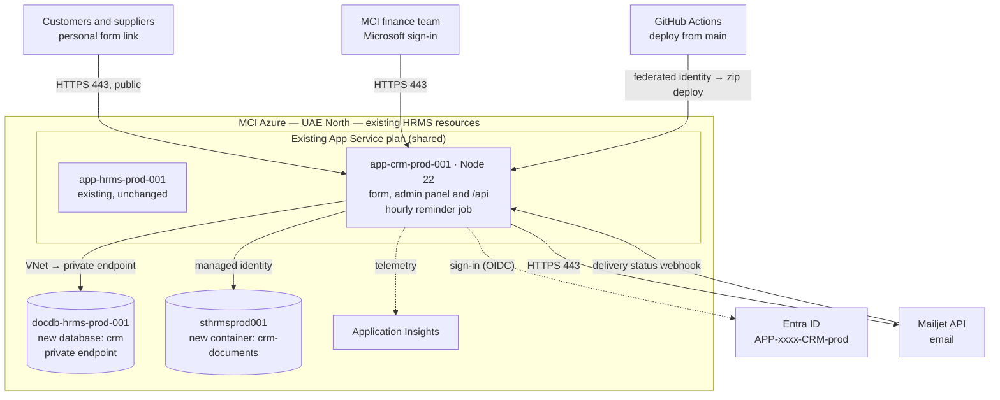
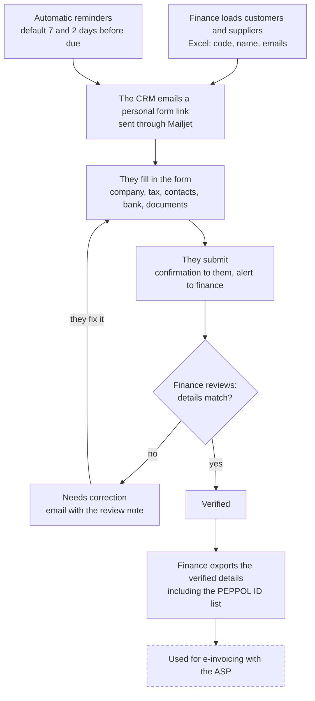

# MCI CRM — Azure Hosting Proposal

Application: MCI CRM (UAE e-invoicing customer and supplier data) · Neuvelabs Technologies, for MCI IT · 3 November 2026

---

## 1. Summary

MCI CRM collects the customer and supplier details MCI needs for UAE e-invoicing. We propose hosting it on the Azure resources MCI already runs for HRMS. That adds no new App Service plan or database cluster, so the extra monthly cost is mainly storage and logs. MCI staff sign in with their Microsoft account, as in HRMS.

**Why it is needed.** Under the UAE e-invoicing mandate, every invoice MCI sends or receives through its e-invoicing provider (ASP) must carry the other party's verified details: legal name, trade licence, TRN, TIN, PEPPOL ID and address. MCI does not hold these details in one checked place today. The CRM collects them once from every customer and supplier, checks them, and gives finance a clean master list to use with the ASP.

**How it works**

1. Finance loads the list of customers and suppliers.
2. The CRM emails each one a personal form link. They fill in one form and upload their documents, with no account.
3. Reminders go out automatically until they respond.
4. Finance reviews each submission against the documents and marks it verified, or asks for a correction.
5. Finance exports the verified details, including the PEPPOL ID list, for use with the ASP.

**Name and hostname.** We suggest **MCI CRM** at **`crm-ae.wearemci.com`**, matching `hrms-ae`. The system holds MCI's customer and supplier details; e-invoicing is its first use.

**What we ask MCI IT for**

| Item | Name | Notes |
| --- | --- | --- |
| Web app on the existing HRMS plan | `app-crm-prod-001` | Linux, Node 22 LTS, 1 instance, Always On, VNet integration as for HRMS |
| Database on the existing cluster | database `crm` on `docdb-hrms-prod-001` | Created by the app on first start |
| Container in the existing storage account | `crm-documents` in `sthrmsprod001` | The CRM's managed identity gets access to this container only |
| Entra app registration | `APP-xxxx-CRM-prod` | Single tenant, assignment required, MCI's numbering |
| Sign-in group | `AZR-xxxx-CRM-prod-Users` | Finance team |
| Hostname + managed certificate | `crm-ae.wearemci.com` | |
| Federated credential for GitHub deploys | `github-mci-crm-main-immutable` | Repo `Neuvelabs-Technologies/MCI-CRM-part`, branch `main`, deploys to `app-crm-prod-001` only |

## 2. Architecture

HRMS keeps its own settings, database, container and IP allow-list. The CRM sits beside it on the same plan with its own identity, database and container.

## 3. Data flow

## 4. Hosting options and cost

Option A shares the HRMS resources and is our recommendation. Option B gives the CRM its own resources, if MCI prefers full separation.

| Resource | Option A: share HRMS resources (recommended) | Option B: dedicated |
| --- | --- | --- |
| App Service plan | Add `app-crm-prod-001` to the existing HRMS plan. No new plan | New plan |
| Database | New database `crm` on `docdb-hrms-prod-001` | New DocumentDB cluster |
| Storage | New container `crm-documents` in `sthrmsprod001` | New storage account |
| Application Insights | Reuse `appi-hrms-prod-001`, filtered by app name | New resource |
| Entra app + group | New (no cost) | New (no cost) |
| New monthly cost | Storage used and log volume only | Adds a plan and a cluster, the two largest items |

**Notes on Option A**

- Both apps use the same plan's CPU and memory. Both are light; if the plan is at its smallest size, moving it up one step is still cheaper than a second plan.
- Each app has its own database on the cluster, and its own blob container with access limited to its own identity.
- Costs show under the HRMS subscription. Tagging the CRM resources `app=crm` keeps them visible.
- Moving to Option B later is simple: copy the database and container, then change two app settings.

## 5. Runtime

| Item | Value |
| --- | --- |
| Language | TypeScript, compiled to JavaScript |
| Runtime | Node.js 22 LTS (22.12 or later) |
| Backend | Express 5, Mongoose 9 |
| Frontend | React + Vite, built to static files and served by the same Express app |
| Startup command | `node dist/server.js` |
| Port | Read from `PORT`, which App Service sets |
| Health check | `GET /api/health` returns 200 with `{"ok":true,"db":"up"}`, or 503 when the database is unreachable |
| Instances | **1.** An hourly reminder job runs inside the app; two instances would send reminders twice |
| Always On | **On** |
| Time zone | `TZ=Asia/Dubai` |
| Logs | JSON lines to stdout, one per request with a request id |

**Uploads.** Customers and suppliers upload scans and photos of licences and IDs. There is no size limit by default (`MAX_FILE_MB=0`). App Service ends any request after 230 seconds, so a very large file on a slow connection could fail; we would then set a limit.

## 6. Database

| Item | Value |
| --- | --- |
| Engine | Azure DocumentDB (MongoDB 7 compatible), existing cluster `docdb-hrms-prod-001` |
| Database | `crm`, separate from HRMS's `hrms` database |
| Collections | Customer and supplier records (form data, review status, email history, document list), MCI legal entities, settings, users, audit log, email delivery log |
| Access | Private endpoint, through the app's VNet integration. No public access |
| Backups | DocumentDB built-in backups, already on for the cluster |

**Sensitive data.** Records hold tax numbers, bank details (IBAN, SWIFT) and contact details. The audit log records every action and sign-in.

## 7. Storage

| Item | Value |
| --- | --- |
| Where | Container `crm-documents` in `sthrmsprod001`, no public access |
| What | Up to 6 documents per company: trade licence, TRN certificate, TIN certificate, signatory IDs, MoA, UBO declaration. Earlier versions are kept when a file is replaced |
| File types | Any document or photo. Programs and scripts are refused by content, not by name |
| Access | The CRM's managed identity gets **Storage Blob Data Contributor on `crm-documents` only** |
| Downloads | Through signed-in routes in the app only, never straight from Blob |
| Protection | The account's existing versioning and 14-day soft delete |
| Retention | Until an admin deletes the record. Period to confirm with MCI finance |

## 8. Network connections

**Outbound from Azure**

| Destination | Port | Purpose |
| --- | --- | --- |
| `api.mailjet.com` | 443 | Send form links, reminders and confirmations; read delivery status |
| `login.microsoftonline.com` | 443 | Microsoft sign-in |
| DocumentDB, Blob Storage | private endpoints | Database and documents |

No SMTP port is needed: Mailjet is called through its HTTPS API.

**Inbound to `crm-ae.wearemci.com`**

| From | To | Port | Why |
| --- | --- | --- | --- |
| Customers and suppliers, anywhere | `/`, `/f/<token>`, `/api/public/*` | 443 | Personal form links. **Must be public** |
| MCI staff | `/admin`, `/api/*` | 443 | Admin panel, Microsoft sign-in |
| Mailjet | `/api/webhooks/mailjet` | 443 | Delivery status, protected by a shared secret |
| GitHub Actions | SCM / Kudu endpoint | 443 | Deploys, Entra token only, as for HRMS |

**Email:** sender `MCI Middle East – Accounts <mci.admin@wearemci.com>`. The `wearemci.com` domain needs Mailjet's SPF and DKIM records so emails don't land in spam.

## 9. Identity, security and access

MCI staff sign in with Microsoft. Customers and suppliers never sign in: their personal link is the key.

**Microsoft sign-in (Entra ID), as in HRMS**

- App registration `APP-xxxx-CRM-prod`: single tenant, assignment required. Redirect URI `https://crm-ae.wearemci.com/auth/callback`.
- Group `AZR-xxxx-CRM-prod-Users` decides who may sign in. MCI adds the finance team.
- Roles (Admin, Finance, Viewer) are given inside the CRM, as in HRMS, so MCI does not need to create app roles.
- MCI's own MFA and Conditional Access policies apply automatically.
- Email-and-password sign-in is turned off in production.

**Form links**

- A random token link per company (`/f/<token>`) that opens only that company's own form.
- Links expire after 90 days by default (a setting finance can change).
- The link is checked before any upload is stored, so made-up links cannot fill storage.
- Rate limits: 300 reads and 30 submissions per 15 minutes per address.

**Built in**

- HTTPS only, TLS 1.2 minimum. Security headers on every response (CSP, nosniff, frame options).
- PDFs and images open in the browser; every other file is downloaded, never opened.
- Every action is written to the audit log.
- Secrets (`JWT_SECRET`, Entra client secret, Mailjet keys) live in App Service settings, or Key Vault references if MCI prefers.

## 10. Deployment and environments

Deploys work like HRMS: a push to `main` runs tests, builds the app and zip-deploys to `app-crm-prod-001` through a federated identity with the immutable subject. That identity can deploy to the CRM app only, not to HRMS.

| Environment | Where | Purpose |
| --- | --- | --- |
| Production | MCI Azure, shared HRMS resources | Live data |
| Staging | Neuvelabs server | Testing and training, demo data only |

Data already collected on the current server is copied to Azure once at go-live.

## 11. Points to confirm with MCI IT

- [ ] **Hostname:** `crm-ae.wearemci.com`.
- [ ] **Hosting:** Option A (shared, lower cost) or Option B (dedicated).
- [ ] **HRMS plan size:** room for a second app, or move up one step.
- [ ] **Entra:** app registration and sign-in group, with MCI's numbering.
- [ ] **Mailjet:** `mci.admin@wearemci.com` verified as sender, and a production API key.
- [ ] **Retention** of documents and bank details.
- [ ] **Key Vault** for secrets, or plain App Service settings.
