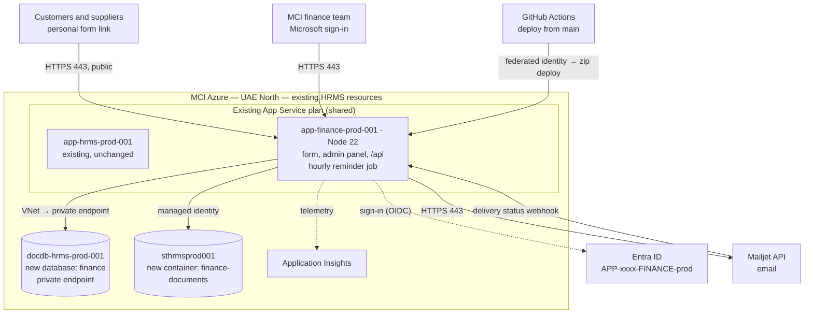

# MCI Finance — Azure Architecture and Requirements

Neuvelabs Technologies, for MCI IT · 4 November 2026

MCI Finance collects and verifies customer and supplier details (legal name, trade licence, TRN, TIN, PEPPOL ID, address, bank details, documents) for UAE e-invoicing. Customers and suppliers fill in one form from a personal link. The MCI finance team reviews and exports the data.

We propose hosting it beside HRMS, on the Azure resources MCI already runs.

---

## 1. Architecture

MCI Finance has its own app, identity, database and container. HRMS is not changed.

## 2. Runtime

| Item | Value |
| --- | --- |
| Hosting | Azure App Service, Linux, on the existing HRMS plan |
| Runtime | Node.js 22 LTS (22.12 or later) |
| Application | TypeScript (Express 5 API + React frontend), built into one Node app |
| Startup command | `node dist/server.js` |
| Port | From `PORT`, set by App Service |
| Health check | `GET /api/health`: 200 when up, 503 when the database is unreachable |
| Instances | **1.** An hourly reminder job runs inside the app; a second instance would send reminders twice |
| Always On | On |
| Time zone | `TZ=Asia/Dubai` |
| Logs | JSON to stdout, sent to Application Insights |
| Uploads | No size limit by default. App Service ends requests after 230 seconds, so a limit will be set if large uploads fail |

## 3. Database

| Item | Value |
| --- | --- |
| Engine | Azure DocumentDB (MongoDB 7 compatible) |
| Location | New database `finance` on the existing cluster `docdb-hrms-prod-001` |
| Access | Private endpoint through the app's VNet integration. No public access |
| Contents | Customer and supplier records, review status, email history, MCI entities, users, audit log |
| Sensitive fields | TRN, TIN, IBAN, SWIFT, contact details |
| Backups | The cluster's built-in backups |
| Setup | Collections and indexes are created by the app on first start |

## 4. Storage

| Item | Value |
| --- | --- |
| Location | New private container `finance-documents` in the existing account `sthrmsprod001` |
| Contents | Up to 6 documents per company: trade licence, TRN, TIN, signatory IDs, MoA, UBO. Earlier versions kept |
| Access | App managed identity with **Storage Blob Data Contributor on this container only** |
| Downloads | Only through signed-in app routes, never directly from Blob |
| Protection | The account's existing versioning and 14-day soft delete |

## 5. Outbound connections

| Destination | Port | Purpose |
| --- | --- | --- |
| `api.mailjet.com` | 443 | Send form links, reminders and confirmations; read delivery status |
| `login.microsoftonline.com` | 443 | Microsoft sign-in |
| DocumentDB, Blob Storage | Private endpoints | Database and documents |

**ASP / Peppol: no connection.** MCI Finance does not send invoices and does not connect to the ASP or the Peppol network. It collects and verifies the customer and supplier details e-invoicing needs (TRN, TIN, PEPPOL ID, address), and the finance team exports them for MCI's e-invoicing setup.

**Next phase: Tally.** TallyPrime, as MCI's ASP, sends e-invoices over Peppol and reports to the FTA. Our connector, installed on the Tally machine, will read data from TallyPrime (such as accounts,  invoices and e-invoice status) and send it to MCI Finance for reporting. It is read-only: it never writes to Tally.

No SMTP port is needed.

## 6. Inbound connections

All on HTTPS 443 to `finance-ae.wearemci.com`.

| From | Path | Access |
| --- | --- | --- |
| Customers and suppliers, any location | `/`, `/f/<token>`, `/api/public/*` | **Public.** Personal link per company, rate limited |
| MCI staff | `/admin`, `/api/*` | Microsoft sign-in |
| Mailjet | `/api/webhooks/mailjet` | Shared secret |
| GitHub Actions | SCM / Kudu | Entra token only |
| Tally connector at MCI (next phase) | `/api/tally/*` | Connector's own key, limited to the Tally machine's public IP |

## 7. Identity and access

- MCI staff sign in with Microsoft. MCI's MFA and Conditional Access apply.
- Only members of `AZR-xxxx-FINANCE-prod-Users` can sign in. Roles (Admin, Finance, Viewer) are set inside MCI Finance; no Entra app roles needed.
- Customers and suppliers do not sign in. Each gets a random link that opens only their own form and expires after 90 days.
- Every action and sign-in is written to an audit log.
- Secrets (`JWT_SECRET`, Entra client secret, Mailjet keys) in App Service settings or Key Vault references, as MCI prefers.

## 8. Azure resources requested

| # | Resource | Name | Configuration |
| --- | --- | --- | --- |
| 1 | Web app on the existing HRMS App Service plan | `app-finance-prod-001` | Linux, Node 22 LTS, 1 instance, Always On, HTTPS only, TLS 1.2 min, VNet integration as for HRMS, system-assigned managed identity |
| 2 | Database on the existing DocumentDB cluster | `finance` on `docdb-hrms-prod-001` | See section 3 |
| 3 | Blob container in the existing storage account | `finance-documents` in `sthrmsprod001` | See section 4 |
| 4 | Application Insights | `appi-hrms-prod-001` (reuse) | Filtered by app name |
| 5 | Entra app registration | `APP-xxxx-FINANCE-prod` | Single tenant, assignment required. Redirect URI `https://finance-ae.wearemci.com/auth/callback` |
| 6 | Entra security group | `AZR-xxxx-FINANCE-prod-Users` | Finance team members |
| 7 | Custom domain + managed certificate | `finance-ae.wearemci.com` | DNS CNAME to the web app |
| 8 | Federated credential for deploys | `github-mci-finance-main-immutable` | Repo `Neuvelabs-Technologies/MCI-Finance`, branch `main`. Contributor on `app-finance-prod-001` only |
| 9 | DNS records on `wearemci.com` | CNAME `finance-ae`; Mailjet SPF and DKIM | So mail from `mci.admin@wearemci.com` is not marked as spam |

Tag all MCI Finance resources `app=finance`. No new App Service plan or database cluster is needed. Data already collected on the current server is copied once at go-live.

## 9. To confirm with MCI IT

- [ ] Hostname `finance-ae.wearemci.com`.
- [ ] HRMS App Service plan has room for a second app, or moves up one size.
- [ ] Entra app registration and group names in MCI's numbering.
- [ ] Mailjet SPF/DKIM records added to `wearemci.com`.
- [ ] Secrets in App Service settings or Key Vault.
- [ ] Document retention period (with MCI finance).
- [ ] For the Tally phase: where TallyPrime runs, and outbound HTTPS 443 from that machine to `finance-ae.wearemci.com`.
- [ ] If MCI prefers full separation from HRMS: a dedicated plan, cluster and storage account instead of resources 1–3.
